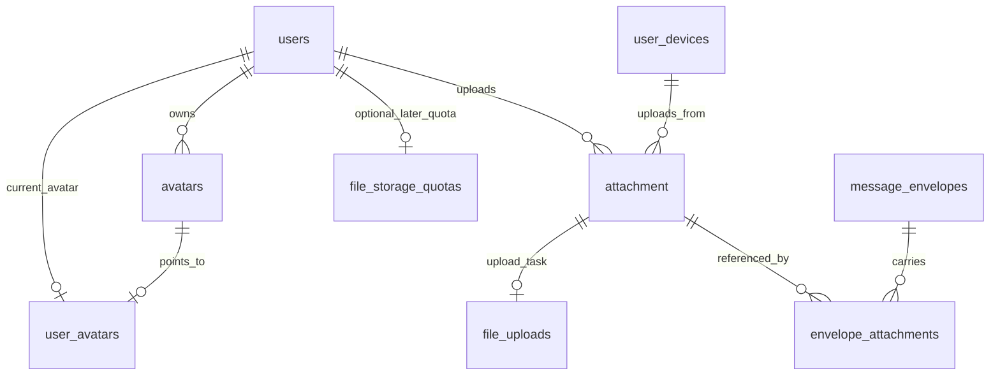

# 文件系统数据表设计

日期：2026-11-03。状态：待实现，配套 [DDL 草案](proposed-schema.sql)。

## 1. 关系与边界

**头像不进入上传任务表。** avatars 只描述已处理完成的普通图片；file_uploads 专用于聊天密文附件。

两类业务仅共用磁盘 I/O 执行器和 FileStorage。头像没有上传批准、任务查询、上传 token、credential_version 或额度预留。

## 2. app.avatars：简单头像表

| 字段 | 类型 | 含义 |
|---|---|---|
| id | UUID | 服务端 avatar_id，换头像生成新 ID |
| uploader_id | UUID | 用户，来自认证，不接受客户端指定他人 |
| storage_key | TEXT UNIQUE | objects/avatars/前2位/次2位/avatar_id.jpg |
| size_bytes | BIGINT NOT NULL | 最终 JPEG 实测字节数 |
| content_type | TEXT | 固定 image/jpeg，后端实际重编码决定 |
| status | TEXT NOT NULL | active / revoked；保存并绑定成功时为 active |
| created_at | TIMESTAMPTZ | 成功保存的时间 |
| revoked_at | TIMESTAMPTZ，可空 | 头像停止使用的时间，不是物理文件删除时间 |

只有图片校验、重编码和文件保存完成才插入，并在同一短事务更新当前头像引用。status 只表示头像是否仍可用，不包含 uploading/verifying 等上传状态。头像无任务 ID、设备 ID、sha256、width/height、expires_at、文件密钥或加密算法字段。处理时仍检查像素等信息，只是不为固定规格头像额外持久化这些数据。

原图仅作为当前请求临时数据，完成后清理。头像无 E2EE，仍用 HTTPS。每次替换创建新对象，不覆盖旧 key；ID 可作为缓存版本。

头像状态为单向 active→revoked，不恢复旧头像。active 时 revoked_at 必须为空，revoked 时必须非空且不早于 created_at，DDL 同时约束。替换头像时在同一事务切换 user_avatars，并将旧头像标为 revoked、写入首次 revoked_at；移除头像时撤销当前头像并删除引用。重复撤销不刷新时间，以免推迟清理。撤销头像与撤销登录设备是不同业务。

维护线程定时分批按 status=revoked 且 revoked_at 超过宽限期筛选，再确认无当前引用；通过有界在途 ID 集合认领，交共用磁盘池 unlink，成功后再删除头像元数据。失败保留记录，重启从数据库重扫。revoked_at 不表示文件已经删除，不增加持久化上传任务。

## 3. app.user_avatars：当前引用

| 字段 | 类型 | 含义 |
|---|---|---|
| user_id | UUID PRIMARY KEY | 一人至多一个当前头像 |
| avatar_id | UUID UNIQUE | 引用 avatars |
| updated_at | TIMESTAMPTZ | 切换时间 |

组合 FK (avatar_id,user_id) → avatars(id,uploader_id) 保证只能绑定本人头像。选择本表为唯一当前来源，不同时维护 users.avatar_attachment_id。

普通上传事务在锁住用户后插入新 active 头像、替换引用并撤销旧头像；没有单独 set_avatar 接口，不允许重新绑定任意旧 avatar_id。没有头像返回 avatar:null。读取需同时命中当前引用且 avatars.status=active；组合外键只保证归属，不会自动保证 active，服务层必须在事务中维护该条件。

## 4. app.attachment：聊天密文文件

| 字段 | 含义 |
|---|---|
| id | attachment_id |
| uploader_id / uploader_device_id | 上传账号/设备，组合 FK 保证归属，active 另验 |
| storage_key | 唯一正式相对路径，objects/attachments/前2位/次2位/attachment_id.bin |
| status | uploading / verifying / ready / failed / deleting / deleted |
| size_bytes / sha256 | 最终密文字节数和 32 字节摘要，发布前可空 |
| content_type | 固定 application/octet-stream，不是原文件 MIME |
| created_at / ready_at / updated_at | 生命周期时间 |
| unreferenced_expires_at | ready 未绑定信封的期限；首次绑定后清空 |
| expires_at | 首次成功绑定时间 + 配置保留期；后续设备引用不延长 |
| deleted_at | 临时和最终文件都确认清理后的时间 |

原文件名、真实 MIME、文件密钥和认证参数只进设备加密消息，不进入附件表或日志。服务器不执行、解压或解码附件，也无法证明密文的明文安全。ready 仅表示可用于消息绑定和授权，不表示已发送。

## 5. app.file_uploads：仅聊天附件上传任务

| 字段 | 含义 |
|---|---|
| id | upload_id |
| attachment_id | NOT NULL UNIQUE，唯一目标，直接 FK 到 attachment |
| uploader_id / uploader_device_id | 与附件一致，组合 FK 保证归属 |
| client_request_id | WebSocket 创建许可的 request_id，UNIQUE(uploader_device_id, client_request_id) |
| expected_size_bytes | 批准的密文正文大小，首版拒绝空对象 |
| expected_sha256 | 可选输入密文摘要，不证明明文安全 |
| state | authorized / receiving / verifying / completed / failed / cancelled / expired |
| upload_token_hash | 短期高熵凭据哈希，仍需认证用户/设备匹配 |
| credential_version | 凭据轮换使旧值失效 |
| reserved_bytes | 后续启用 quota 时的任务预算；首版不启用则为 0，不读写 quota 表 |
| expires_at | 上传截止，不是文件保留期 |
| created_at / updated_at / finished_at | 时间 |
| failure_code | 受控诊断码 |

没有 avatar_id、kind、purpose，也没有任何指向 avatars 的 FK。头像普通请求不会创建或查询此表。

通过 WebSocket 申请、查询、续签、取消，详见 [协议设计](attachment-protocol.md)。任务属于 user/device，不属于原 socket，WebSocket 正常断开不自动取消 HTTP 上传。完成后持久化状态，再尝试 ready 提示；重连查询恢复。

首版每个附件只有一个任务；失败后不重新打开，新上传使用新 client_request_id 和新对象。创建重试核对 expected_size/expected_sha256，不同参数冲突。凭据丢失只允许 authorized 任务重新认证后轮换，receiving/verifying 不允许并行接收。

authorized→receiving 用条件更新认领；实时接收字节放 Reactor Session，不逐块写库。无可靠检查点时进程重启不续传，清理后重新上传。

## 6. app.file_storage_quotas：后置可选的附件额度

| 字段 | 含义 |
|---|---|
| user_id | 用户主键 |
| quota_bytes | 聊天附件配置额度 |
| used_bytes | 正式附件字节，物理删除成功才减 |
| reserved_bytes | 尚未结算的附件任务预算 |
| updated_at | 显式更新时间 |

本阶段可不建此表，不作为头像或附件核心流程的前置。草案单独在 [optional-quota.sql](optional-quota.sql)；首版 file_uploads.reserved_bytes=0，配额未启用的任务结算保持 0，不允许客户端选择额度模式。仍需单文件、每用户活动任务、全局缓冲/磁盘上限与到期清理。

不统计 avatars，也不因头像上传创建 quota/reservation。头像通过严格输入/输出大小、每用户频率、全局并发、临时容量与旧头像清理控制资源。

后续启用此功能时，附件申请短事务原子预留并确保 used+reserved<=quota；成功时减 reservation、增最终 size，attachment ready、file_uploads completed 同事务提交。失败在清理残留后才释放预算。数据库预留不等于文件系统实际预分配，仍需低水位和 ENOSPC 处理。

## 7. app.envelope_attachments：附件消息引用与设备授权

| 字段 | 含义 |
|---|---|
| envelope_id / attachment_id | 联合主键，FK 到实际信封与 attachment |
| created_at | 绑定时间 |

不引用 avatars，不加旧 app.message 外键。接收者从信封 JOIN 取得。新发送校验附件归属、ready/有效期，并在保存信封的同一事务插入关联；一个密文可供多设备复用。

下载要求当前设备 active 且为信封 recipient，上传者读取另行授权；同账号新设备不自动继承历史授权。删除好友不撤回已投递附件，期限仍有效。

幂等包含 packet/protocol 和排序去重后的 attachment_ids；相同重试返回原信封，不追加权限或延长期限；不同集合冲突。先查原请求，再检查新发送附件状态，允许过期后查询原提交结果。

## 8. 并发与迁移

- 附件沿用设备对 advisory lock、设备/账号、quota、排序 attachment、file_uploads/引用的统一锁序。清理和绑定共享 attachment 行锁。
- 头像走单独短事务，锁用户行串行化更新/移除与撤销；切换引用和写旧头像 status/revoked_at 一起提交。文件处理期间不持数据库 lease。旧头像不允许再次绑定，清理时仍重查 user_avatars。
- 头像数据库没有半成品状态，文件已保存而事务失败产生孤儿，由补偿/宽限扫描处理。详情见 flows.md。
- 头像和附件清理分别执行，不能扫描 avatars 后到 file_uploads 找任务，也不能从删除头像时扣附件 quota。
- 使用现有 user_devices(device_id,user_id) 唯一索引的只有附件对象/任务外键；头像不要求引入新的设备上传协议。
- 全目标为 6 张表，其中 proposed-schema.sql 为 5 张核心表，optional-quota.sql 为后置表。若之前已按混合方案落库，需专门转换 avatar 任务、额度和引用，并清理未完成任务后再移除字段；不能直接执行草案 CREATE/DROP。
- 当前 SQL 未执行，实际 schema、role 权限、数据与已有路径必须在正式迁移前核对。
